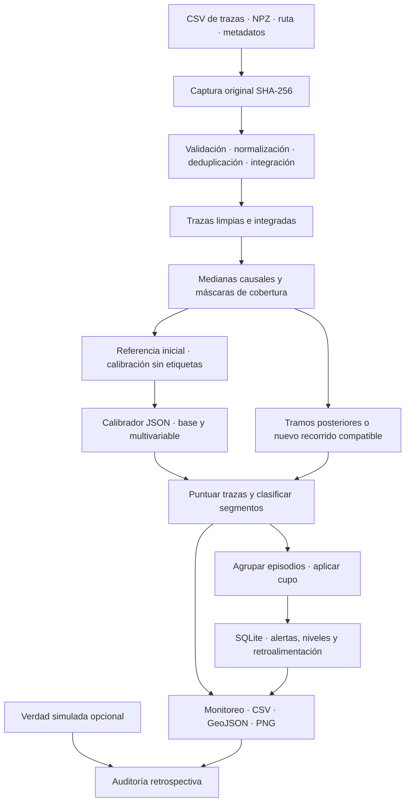

# Arquitectura, validación y uso de GEOPREDICT

## Problema y decisiones

La entidad física es un tramo de vía. El sensor virtual registra trazas ordenadas en un recorrido por la Avenida Regional. Cada traza enlaza con la señal observada a través de `trace_id`. Un segmento longitudinal de **5 m** es la unidad de evaluación y un grupo de segmentos altos contiguos es la unidad de alerta. El recorte actual mide 334,52 m. La ETL toma la geometría y la longitud de los archivos existentes.

La amplitud, la energía y el tiempo de pico describen la señal. La persistencia de retornos superiores a la referencia es evidencia para priorizar revisión. Un retorno puede corresponder a infraestructura, humedad, variaciones constructivas o cambios de adquisición. La acción del piloto es revisar señal, acoplamiento y redes existentes. Si la evidencia persiste, se puede solicitar verificación de campo. Las alertas se guardan localmente para revisión y auditoría.

La fecha de corte de cada segmento es la adquisición de su última traza. La priorización por cupo dispone de todo el recorrido y tiene su propio corte, el de la última traza de inferencia. El piloto tiene **horizonte no estimable y anticipación no medida**. El evento futuro de negocio sería una pérdida de soporte confirmada mediante inspección independiente e identificada espacial y temporalmente. Un eventual protocolo supervisado usaría segmento y fecha de levantamiento como unidad y corte, solo observaciones anteriores como historial y, como hipótesis de investigación a validar, un horizonte de 30 días. Serían positivos los segmentos con un evento confirmado dentro de ese horizonte, negativos los que tengan seguimiento verificable durante todo el intervalo sin evento, y censurados los que carezcan de seguimiento suficiente. La ventana histórica se fijaría con la frecuencia de levantamiento y el horizonte con la capacidad de respuesta. La geometría simulada estática solo se utiliza en auditoría retrospectiva.

## Arquitectura

CSV facilita la integración local, NPZ conserva las señales y SQLite da transacciones y claves únicas a eventos operativos. Las fuentes y configuraciones quedan identificadas por SHA-256. Una nueva pasada compatible se puede cargar como lote adicional con la referencia ya calibrada y fecha posterior. La unidad incremental es una pasada completa. Una revisión de la pasada de referencia requiere recalibrar. Los archivos procesados se reemplazan atómicamente por archivo y los manifiestos identifican su lote. Los reintentos mantienen claves y estados en SQLite. Las ejecuciones del mismo destino se deben serializar si se publican versiones distintas.

## Calidad e integración

El lector identifica columnas, normaliza nombres y exige el contrato versionado. Conserva el original, analiza tipos, distingue duplicados exactos de conflictos de clave y valida el orden del reloj, la correspondencia entre paso y velocidad, el CRS, las huellas del eje y de la configuración, los límites de atributos, los IDs y la forma y el eje temporal de la señal observada. Se retiran las 352 copias idénticas al publicar la tabla limpia. Un conflicto, archivo faltante, violación de referencia o corrupción da lugar a un fallo de etapa registrado. La integración agrega `npz_row` para enlazar cada traza a la matriz por ID.

Los nulos se conservan y se manejan con cobertura mínima en cada ventana. Los atípicos se conservan. La fracción extrema superficial se calcula respecto a la referencia y orienta la inspección de adquisición. La etiqueta de atípico inyectado y los perfiles simulados quedan fuera del flujo operativo. Los identificadores de pasada y canal son categorías de agrupación y auditoría, sin codificación para el calibrador. Tiempo y posición sirven para ordenar y georreferenciar.

## Calibración y niveles

La referencia inicial ocupa PK 0 a menos de 45 m. Se deja un resguardo de 5 m y la inferencia empieza en PK 50 m. La longitud del resguardo evita que las ventanas de inferencia toquen las usadas para ajustar el calibrador. Cada ventana de 2 m mira hacia atrás e incluye la traza actual. La referencia es inicial y experimental, con 869 ventanas completas en este lote. La evaluación posterior usa una sola pasada y no constituye una prueba independiente por recorrido.

La regla base usa RMS medio. El enfoque multivariable toma el máximo de las desviaciones positivas respecto a la localización robusta en RMS medio, RMS tardío y pico absoluto. En términos de cálculo toma el máximo de los valores estandarizados con signo, por lo que también distingue observaciones por debajo del centro de referencia. Ambos comparten cobertura y reglas de segmentación. El multivariable se usa en el piloto para priorizar distintos tipos de retornos, con factores trazables por alerta. Se incluyó una comparación con persistencia de 10 %, 20 % y 30 %. Los percentiles 95 y 99 provienen de la distribución empírica de calibración. El 20 % de persistencia equivale a 20 trazas en un segmento completo a 5 cm y es una decisión inicial para amortiguar picos aislados. El cupo predeterminado de cuatro episodios es una hipótesis operativa configurable.

Un segmento queda sin cobertura si menos del 75 % de sus trazas esperadas tiene características válidas. Con cobertura, es alto si al menos 20 % excede el umbral alto, moderado si alcanza ese porcentaje solo para el umbral moderado y bajo en otro caso. Los tramos altos contiguos se fusionan. El orden usa el P90 del desvío robusto del segmento representativo, con desempate por PK. La escala 0 a 100 es un percentil de referencia y puede saturarse en 100. Una categoría crítica requeriría criterios independientes de gravedad y confirmación.

La identidad de una alerta combina la pasada, el primer segmento del episodio y el tipo de revisión. Los reintentos conservan fecha y estado. SQLite registra cambios de nivel al reevaluar la misma pasada e incorpora revisiones con clave idempotente. El seguimiento entre pasadas se puede hacer por PK para este eje. Falta evidencia operativa para definir cuándo episodios de pasadas distintas representan el mismo incidente físico. Los cambios se exportan en `cambios_nivel.csv` y la retroalimentación tiene su propio historial.

## Resultados comprobados

| Medida | Resultado |
| --- | --- |
| ETL | 7.043 filas leídas, 352 copias exactas y 6.691 trazas integradas. |
| Niveles multivariables | 57 segmentos, con 37 bajos, 4 moderados, 9 altos y 7 sin cobertura. |
| Episodios y carga | 6 episodios candidatos, 4 alertas emitidas dentro del cupo, 2 fuera del cupo. |
| Regla base con persistencia de 20 % | 3 segmentos altos y 3 episodios. |
| Sensibilidad multivariable | Con 10 %, 20 % y 30 % de persistencia hubo 8, 6 y 5 episodios, respectivamente. |
| Auditoría sintética | El método base, el multivariable y las alertas emitidas coincidieron espacialmente con 1 de 4 cavidades. Las demás alertas pueden corresponder a otros retornos, como tuberías o tablero. |
| Rendimiento futuro | Precisión, sensibilidad operativa, PR-AUC, calibración de probabilidades, falsos positivos por periodo y tiempo de anticipación quedan sin evaluar. |

El multivariable amplió la carga de revisión y no aumentó la cobertura espacial de cavidades en esta prueba. La calificación actual es experimental. La auditoría utiliza la geometría del mismo lote tras terminar la inferencia. Sus cifras no se usaron para seleccionar parámetros ni ajustar el calibrador.

## Monitoreo y despliegue

- **En cada carga**, registrar esquemas, duplicados, nulos, errores, firma instrumental y compatibilidad de ruta. Un fallo de integridad bloquea la etapa. Revisar cobertura y el estado de los segmentos sin puntuación antes de interpretar el mapa.
- **En pasadas comparables**, observar la fracción de ventanas válidas, el desvío de la mediana frente a la escala robusta, la distribución de puntuaciones, episodios, carga fuera del cupo y revisiones pendientes. Un cambio persistente en pasadas comparables inicia una investigación de instrumento, acoplamiento y entorno. Una sola desviación puede reflejar el tramo o el escenario, por lo que no se trata como deriva confirmada.
- **Con seguimiento independiente**, establecer una línea base de falsos positivos, omisiones y carga de inspecciones. Para un estudio supervisado, separar por fecha y recorrido, respetar el horizonte y evitar compartir el mismo objeto entre conjuntos. Medir PR-AUC, precisión a cupo, sensibilidad, falsas alertas por periodo, anticipación y costos. Evaluar calibración si se emiten probabilidades.
- **Antes de cambiar umbrales**, repetir el análisis de persistencia con recorridos independientes, cargas observadas y el costo de gestionar casos. Versionar toda revisión. Un cambio persistente de adquisición requiere calibración compatible. Un cambio confirmado en la relación entre indicadores y eventos exige reevaluar el modelo con datos recientes.
